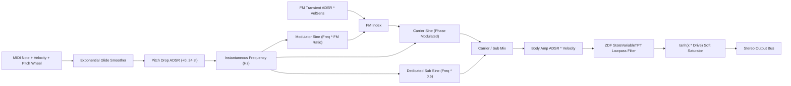
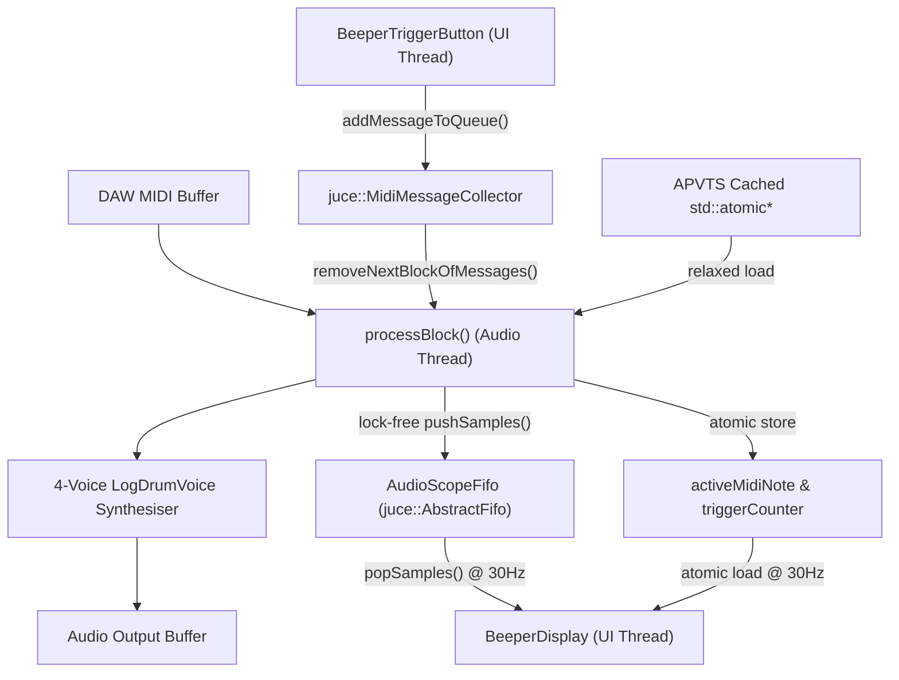

# ExtasisLogDrum — Signal & System Architecture (v1.0.0)

## 1. Per-Voice DSP Signal Flow

---

## 2. Thread-Safe Audio / UI Architecture

ExtasisLogDrum enforces strict real-time safety on the audio thread (zero mutex locks, zero heap allocations, zero string lookups):

---

## 3. Source Code Layout

- `Source/PluginProcessor.h` / `.cpp`: `AudioScopeFifo`, `LogDrumVoice`, `LogDrumSound`, `ExtasisLogDrumAudioProcessor`, APVTS parameters, and 10 factory presets.
- `Source/PluginEditor.h` / `.cpp`: Compact `520×440` hardware chassis layout, 3-module knob grid, double-click reset, and preset selector.
- `Source/GUI/BeeperDisplay.h` / `.cpp`: Dot-matrix backlit LCD screen, zero-crossing stabilized oscilloscope, parameter readout, and live MIDI note display.
- `Source/GUI/BeeperLookAndFeel.h` / `.cpp`: KORG MS-20 rotary knob renderer and dark/green-LCD ComboBox & PopupMenu styling.
- `Source/GUI/BeeperTriggerButton.h` / `.cpp`: Tactile rubber pad with embedded logo, vertical drag pitch-shifting (`±24 st`), and right-click/double-click reset.
