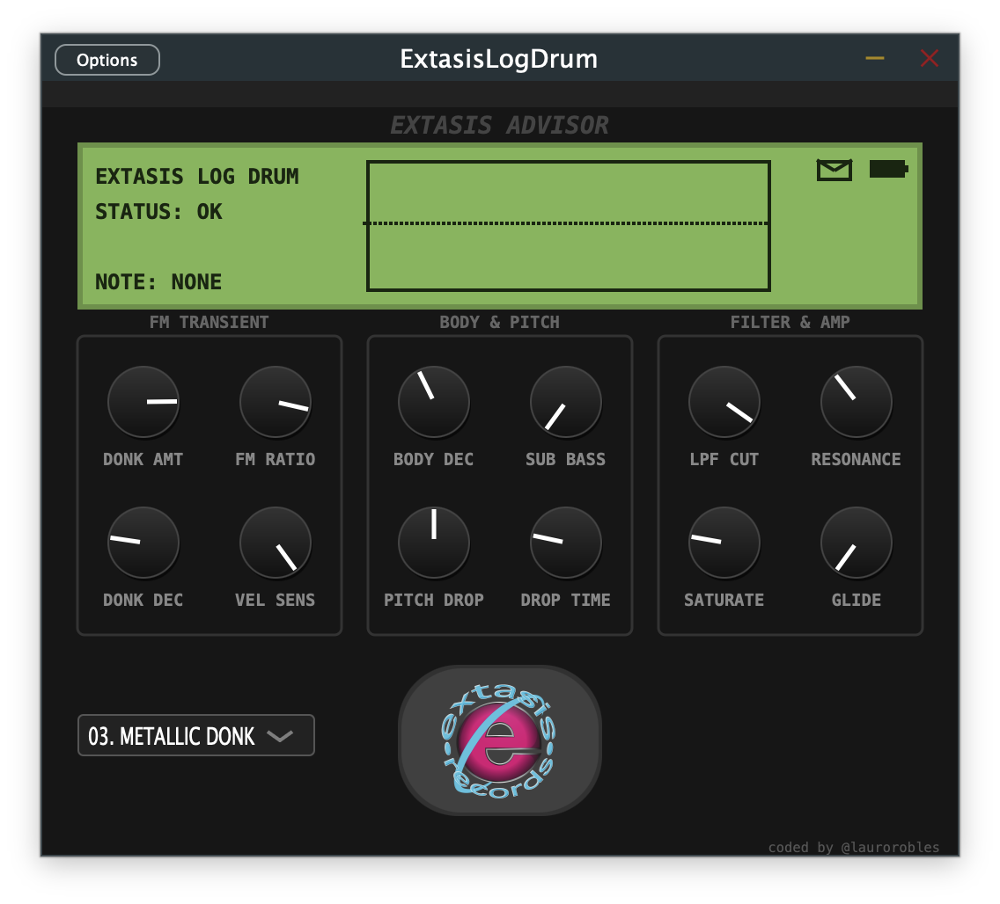

# ExtasisLogDrum

[](LICENSE)
[](CHANGELOG.md)
[](#installation)
[](#build-from-source)

**ExtasisLogDrum** is a **100% Free & Open Source** Amapiano Log Drum synthesizer built in C++20 & JUCE 8 by **ExtasisRecords (`@laurorobles`)**.

Instead of relying on static wood samples, ExtasisLogDrum models the authentic percussive-bass topology of the iconic Amapiano Log Drum using pure **Phase Modulation (FM/PM)**, a dedicated octave-below **Sub-Bass** sine oscillator, a fast **Pitch Drop** envelope, a **Zero-Delay Feedback Lowpass Filter**, and analog-style `tanh` saturation — wrapped in a compact 90s Motorola Pager (*Extasis Advisor*) + KORG MS-20 hardware interface.



---

## Features

- **Pure FM/PM Log Drum Engine**: Sine carrier + sine modulator with adjustable FM Amount, FM Ratio (`1x–8x`), FM Decay, and Velocity Sensitivity.
- **Body & Pitch Architecture**: Dedicated phase-coherent octave-below Sub-Bass oscillator, Body Decay, Pitch Drop (`0–24 st`), and Drop Time.
- **Filter, Drive & Glide**: Zero-delay feedback Lowpass Filter (`StateVariableTPTFilter`), Resonance, soft-clipping `tanh` Saturation, and smooth cross-voice Glide.
- **90s Pager LCD Display**:
  - Real-time dot-matrix oscilloscope with rising-edge zero-crossing trigger stabilization (100% lock-free audio pipeline).
  - Live MIDI note monitor (responds to both DAW MIDI and the built-in Trigger Pad) + animated pager message icon.
  - Formatted parameter readout with real units (`ms`, `Hz`, `st`, `%`, `x`).
- **Tactile Trigger Pad with Pitch Drag**: Click and hold the central Extasis logo pad to audition, and drag vertically to shift pitch (`±24 semitones`). Right-click or double-click to reset to `C1`.
- **10 Factory Presets**: Ready-to-use Amapiano, Deep Sub, Metallic Donk, Pluck, Overdrive, and Gliding Bass patches (also exposed to your DAW's native preset bar).
- **Double-Click Reset**: Double-click any knob to instantly return it to its default value.

---

## Installation

Download the latest free release for your operating system from the [GitHub Releases](../../releases) page:

### macOS (Apple Silicon & Intel Universal)
1. Unzip `ExtasisLogDrum-macOS-Universal.zip`.
2. Double-click `installer/INSTALL_MAC.command` (installs **VST3**, **AU**, and **Standalone** and clears macOS quarantine flags automatically).
3. Open your DAW and rescan plugins.

### Windows (64-bit)
1. Unzip `ExtasisLogDrum-Windows-x64.zip`.
2. Right-click `installer/INSTALL_WINDOWS.bat` and choose **Run as administrator** (installs **VST3** to `C:\Program Files\Common Files\VST3\`).
3. You can also launch `ExtasisLogDrum.exe` directly for Standalone use.

### Linux (64-bit)
1. Unzip `ExtasisLogDrum-Linux-x64.zip`.
2. Run `bash installer/INSTALL_LINUX.sh` (installs **VST3** to `~/.vst3/` and **Standalone** to `~/.local/bin/`).
3. Open your DAW and rescan VST3 plugins.

---

## Controls Overview

| Module | Control | Description |
| :--- | :--- | :--- |
| **FM TRANSIENT** | **DONK AMT** | Phase modulation depth (`0–100%`). Controls the woody/metallic attack knock. |
| | **FM RATIO** | Modulator-to-carrier frequency ratio (`1.0x–8.0x`). Classic DX10 Log Drum uses `4.0x`. |
| | **DONK DEC** | Decay time of the FM transient (`1–150 ms`). Short = tight knock; long = synth bass. |
| | **VEL SENS** | Maps incoming MIDI velocity to FM depth (`0–100%`) for expressive grooves. |
| **BODY & PITCH** | **BODY DEC** | Amplitude decay of the bass body (`50–3000 ms`). |
| | **SUB BASS** | Blends in a pure sine wave one octave below the carrier (`0–100%`). |
| | **PITCH DROP** | Initial upward pitch envelope depth (`0–24 st`) for percussive punch. |
| | **DROP TIME** | Decay speed of the pitch drop (`10–200 ms`). |
| **FILTER & AMP** | **LPF CUT** | Lowpass filter cutoff frequency (`50 Hz – 10 kHz`). |
| | **RESONANCE** | Filter resonance (`0.1x – 2.0x`). |
| | **SATURATE** | Analog-style `tanh` drive (`1.0x – 10.0x`) for harmonic weight on small speakers. |
| | **GLIDE** | Portamento glide time between notes (`0–500 ms`). |

For full sound-design tips and MIDI details, see [MANUAL.md](MANUAL.md), [TECHNICAL.md](TECHNICAL.md), and [ARCHITECTURE.md](ARCHITECTURE.md).

---

## Build from Source

### Requirements
- **CMake** 3.15+
- **C++20 compiler** (Xcode Command Line Tools on macOS, MSVC 2022 on Windows)
- Internet access on first configure (CMake automatically fetches **JUCE 8** via `FetchContent`)

### Commands
```bash
git clone https://github.com/laurorobles/ExtasisLogDrum.git
cd ExtasisLogDrum
cmake -B build -DCMAKE_BUILD_TYPE=Release
cmake --build build --config Release --parallel
```

Built artifacts are placed in `build/ExtasisLogDrum_artefacts/Release/` (`VST3`, `AU`, `Standalone`).

---

## License & Credits

**ExtasisLogDrum** is free and open-source software licensed under the **GNU General Public License v3.0 (GPL-3.0)**. See [LICENSE](LICENSE) for full details.

- **Concept, DSP & GUI**: `@laurorobles` — **ExtasisRecords**
- **Framework**: [JUCE](https://juce.com/)
